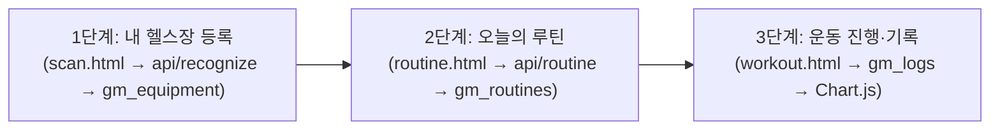

# AGENTS.md - GymMate AI 개발 가이드 및 에이전트 지침서

이 문서는 AI 에이전트와 개발자가 GymMate(헬스장 기구 인식 및 맞춤형 운동 루틴 추천 웹앱) 프로젝트를 구현하고 유지보수할 때 반드시 준수해야 하는 핵심 규칙과 가이드라인을 정의합니다.

---

## 1. 프로젝트 개요 (Overview)
- **서비스명:** GymMate (짐메이트)
- **목적:** 헬스 0~2개월 차이고 혼자 운동하는 대학생이 "따라 하기가 아니라 순서의 이유를 이해"하도록 돕는 서비스
- **핵심 흐름:** 처음 한 번 기구 사진으로 '내 헬스장'을 등록 → 이후 홈에서 '오늘 운동 시작' → 조건 선택 → 등록 기구만 쓴 루틴 생성
- **하지 않는 것:** 자세 교정, 회원가입과 서버 DB, 식단, 커뮤니티, 네이티브 앱
- **참조 문서:** 짐메이트 AI — PRD (2026-11-12). AGENTS.md와 PRD가 충돌하면 PRD를 따르고, 이 문서도 함께 고칩니다.

---

## 2. 절대 준수 규칙 (Core Rules)

### 📌 규칙 1. 기술 스택 제약 (순수 HTML/CSS/JS + Vercel 서버리스)
- **프론트엔드:** 프레임워크(React, Vue, Next.js, Angular 등) 및 빌드 도구(Webpack, Vite, Rollup, Babel, PostCSS 등)의 **사용을 엄격히 금지**합니다.
  - 정적 파일 구조: 페이지별 HTML(`index.html`, `scan.html`, `routine.html`, `workout.html`) + `css/style.css` + `js/*.js` (일반 `<script>`로 불러오는 전역 객체 방식)
  - 외부 라이브러리는 3단계의 Chart.js만 CDN `<script>`로 허용합니다.
- **백엔드 (API):** Vercel 서버리스 함수(`api/*.js`, Node.js CommonJS 또는 ES Module 환경)만 사용합니다.
- 패키지 의존성(npm dependencies)은 서버리스 함수에 필요한 최소한(예: node-fetch 등 필요 시)으로 제한하며, 프론트엔드 번들러는 일체 두지 않습니다.

### 📌 규칙 2. OpenRouter API 호출 및 보안 규칙
- **호출 위치:** OpenRouter API 호출은 반드시 **`api/` 폴더 안의 서버리스 함수**에서만 수행합니다. 클라이언트 브라우저(`js/*.js`)에서 직접 OpenRouter로 요청을 보내는 것은 보안상 엄격히 금지됩니다.
- **환경 변수 사양:**
  - API Key: `process.env.OPENROUTER_API_KEY`
  - 모델명: `process.env.OPENROUTER_MODEL` (환경변수 미설정 시 기본값: `"google/gemma-4-26b-a4b-it:free"`)
- **API 헤더:** OpenRouter 권장 표준 헤더(`Authorization: Bearer ...`, `HTTP-Referer`, `X-Title: GymMate`)를 필수로 포함합니다.

### 📌 규칙 3. 단계별/기능별 점진적 개발 및 확인 절차
- **한 번에 한 가지 기능만 개발:** 복수의 단계를 동시에 구현하지 않고, 원자적(atomic) 단위로 구현합니다.
- **확인 방법 제시:** 기능 구현 완료 시, 사용자가 브라우저나 터미널에서 어떻게 결과를 검증하고 테스트할 수 있는지 구체적인 확인 단계(체크리스트)를 반드시 안내합니다.

### 📌 규칙 4. 전 코드 한국어 주석 필수
- 모든 작성 코드(`HTML`, `CSS`, `JavaScript`, `Vercel 서버리스 함수`)에는 역할, 함수 동작 원리, 매개변수, 예외 처리 이유 등을 **명확한 한국어 주석**으로 상세히 작성합니다.

### 📌 규칙 5. 환경 변수 및 형상 관리 (.env.local / .gitignore)
- API 키 등 민감 정보는 `.env.local` 파일에서 관리하며, 절대 git 커밋에 포함되지 않도록 `.gitignore`에 등록합니다.
- `.gitignore` 필수 등록 항목:
  ```text
  .env
  .env.local
  .env.*.local
  node_modules/
  .vercel/
  ```

### 📌 규칙 6. 터미널 명령 직접 실행 및 결과 설명
- 패키지 설치, 로컬 서버 구동, 파일 검증 등 개발에 필요한 모든 터미널 명령은 에이전트가 직접 터미널 툴(`run_command`)을 통해 실행하고, 그 실행 결과와 성공 여부를 사용자에게 한국어로 친절히 설명합니다.

---

## 3. 프로젝트 디렉토리 구조 (Directory Structure)

다중 페이지 구조입니다. 각 HTML은 필요한 `js/*.js`만 일반 `<script>`로 불러옵니다.

```text
gymmate/
├── .env.local          # 로컬 개발 환경 변수 (OPENROUTER_API_KEY 등, git 제외)
├── .gitignore          # 형상 관리 제외 목록
├── AGENTS.md           # 본 개발 지침서
├── index.html          # 홈 = 내 헬스장 (등록 기구 목록, 기구 추가, 오늘 운동 시작)
├── scan.html           # 기구 등록 (촬영/앨범 → 인식 → 카드 확인 → 저장)
├── routine.html        # 오늘의 루틴 (조건 칩 선택 → 루틴 생성·표시)
├── workout.html        # 3단계: 운동 진행·기록
├── css/
│   └── style.css       # 모바일 퍼스트 공통 스타일시트
├── js/
│   ├── storage.js      # LocalStorage 읽기·쓰기 (gm_* 키 관리)
│   ├── image.js        # 이미지 리사이즈(긴 변 1024px)·JPEG 0.85 base64 변환
│   └── (페이지별 스크립트: home.js, scan.js, routine.js 등)
├── api/                # Vercel 서버리스 엔드포인트 (OpenRouter 호출은 여기서만)
│   ├── recognize.js    # 기구 사진 인식 API
│   └── routine.js      # 등록 기구 기반 루틴 생성 API
├── dev-server.js       # npm 설치 없이 정적 파일 + api/*를 띄우는 로컬 개발 서버
└── package.json        # 실행 스크립트 정의 (npm run dev)
```

### LocalStorage 키 (서버 DB 없음)
| 키 | 내용 | 단계 |
|---|---|---|
| `gm_equipment` | 등록 기구 목록 `{id, name_ko, name_en, target_muscles[], role, setup[], cautions[], created_at}` | 1 |
| `gm_profile` | 마지막 조건 `{goal, default_minutes}` (PRD의 experience는 사용자 결정으로 제외) | 2 |
| `gm_routines` | 생성 루틴 `{id, date, conditions, principle, warmup, exercises}` | 2 |
| `gm_logs` | 운동 기록 | 3 |

- 사진은 인식에만 쓰고 **저장하지 않습니다.**

---

## 4. 로드맵 및 단계별 구현 가이드



### [Step 1] 1단계: 내 헬스장 등록
1. **이미지 입력 (F1-1):** 촬영 버튼과 앨범 버튼 분리, 긴 변 1024px·JPEG 0.85로 축소 (`js/image.js`)
2. **인식 API (`api/recognize.js`):** `{is_equipment, name_ko, name_en, target_muscles[], role, setup[], cautions[], confidence("high"|"low"), alternatives[]}` 반환, 형식 검사와 1회 재시도
3. **결과 카드 (`scan.html`):** 확신도가 낮으면 후보 선택(F1-2), 이름 수정(F1-3), "통증이 있으면 즉시 멈추세요" 항상 표시, `gm_equipment`에 저장
4. **홈 (`index.html`):** 등록 기구 목록, 기구 카드 열기(F1-5), 삭제 확인(F1-4)

### [Step 2] 2단계: 오늘의 루틴
1. **조건 선택 (F2-1):** 칩만 사용(타이핑 없음) — 목표(근육 늘리기/체력/체중 감량), 시간(30/45/60분), 부위. 마지막 값은 `gm_profile`에 저장
   - 경력 선택은 하지 않습니다. 대상이 모두 헬스 0~2개월 초보라 의미가 없어 뺐습니다(2026-11-19 사용자 결정, PRD와 다른 부분).
2. **루틴 API (`api/routine.js`):** 등록 기구 목록만 사용, `{principle, total_minutes, warmup, exercises[{order, equipment_id, exercise, sets, reps, rest_sec, why_this_order}]}` 반환, 목록에 없는 기구는 서버에서 걸러냄(`filtered_count`)
3. **결과 화면:** principle 강조 → 워밍업 → 순서별 운동 카드(누르면 기구 카드), `gm_routines`에 저장, 다시 만들기

### [Step 3] 3단계: 운동 진행·기록
1. **세트 체크·휴식 타이머 (F3-1)** (`workout.html`)
2. **기록 저장:** `gm_logs` (LocalStorage, 서버 DB 없음)
3. **시각화:** Chart.js(CDN)

---

## 5. 로컬 개발 및 테스트 실행 방법

1. **환경 변수 파일 생성 (`.env.local`):**
   ```env
   OPENROUTER_API_KEY=your_openrouter_api_key_here
   OPENROUTER_MODEL=google/gemma-4-26b-a4b-it:free
   ```
2. **로컬 서버 구동:**
   - `npm run dev` (= `node dev-server.js`): npm 설치 없이 정적 파일과 `api/*.js`를 함께 띄웁니다. Vercel CLI를 쓰려면 `npm run dev:vercel`.
   - 포트: 기본 `http://localhost:3000`
3. **검증 가이드라인:**
   - 에이전트는 코드를 추가/수정한 후 변경 사항과 함께 테스트 방법(예: 어떤 버튼을 누르고 어떤 응답이 와야 하는지)을 사용자에게 단계별로 설명해야 합니다.
